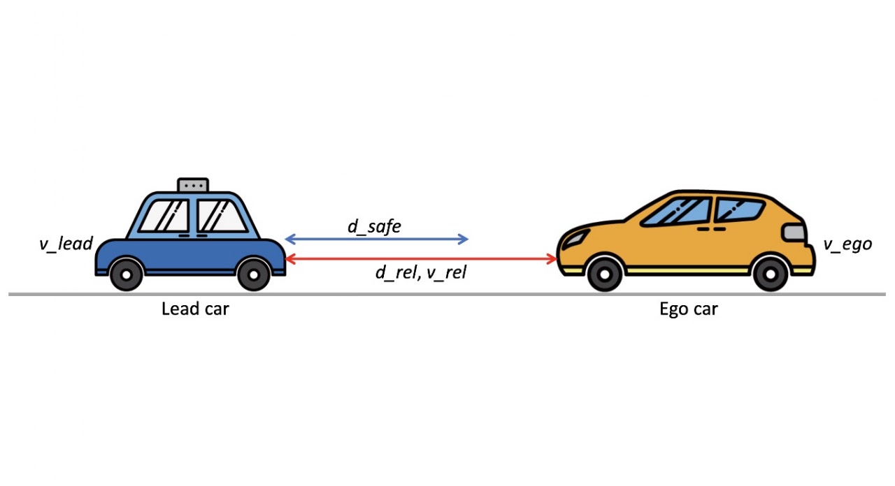
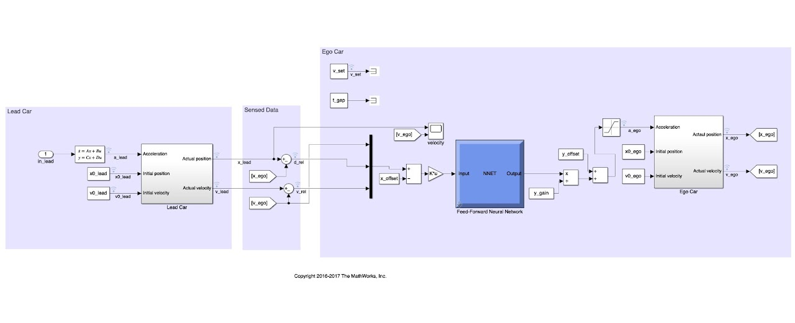
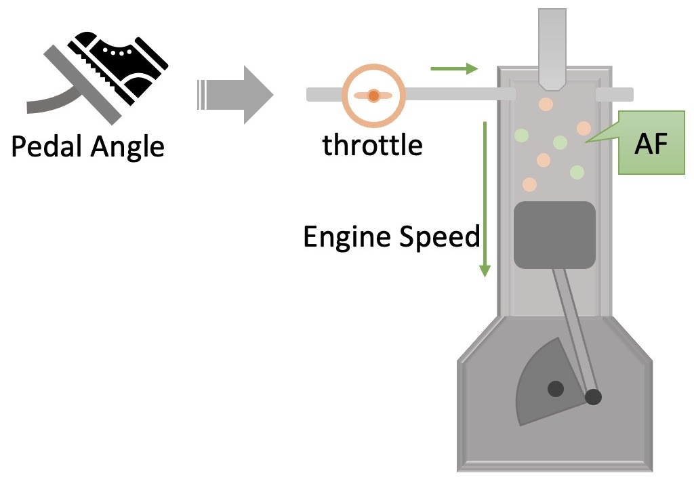
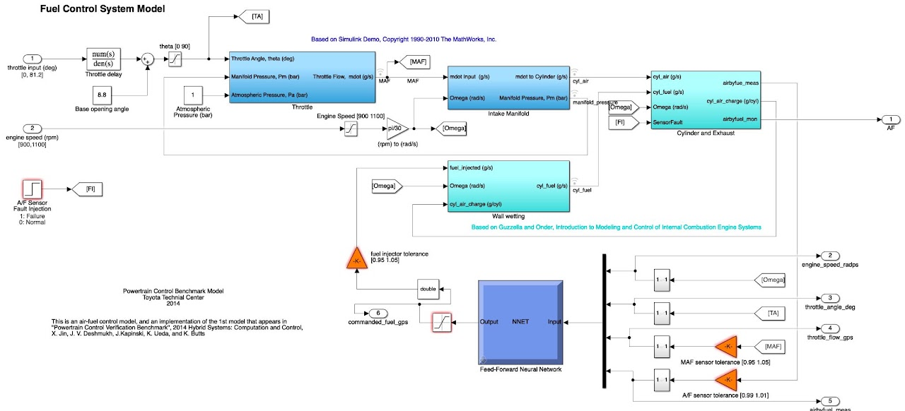
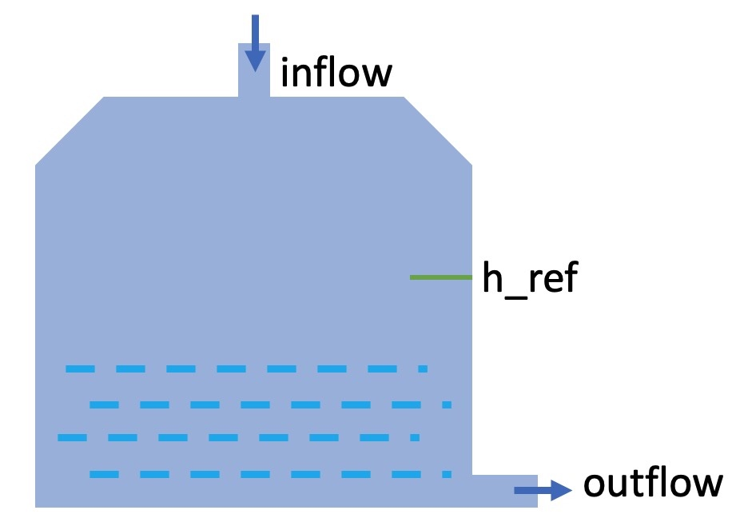
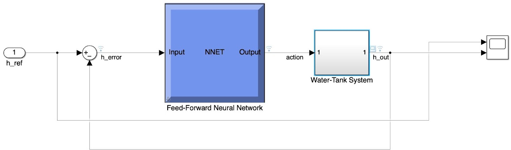
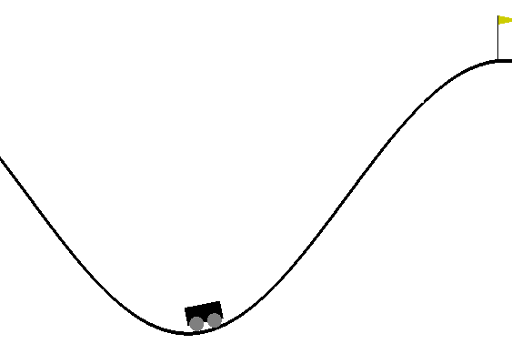

# Benchmarks

We adopt seven AI-enabled CPS spanning four application domains (Table II of the paper). Except for
MC, the systems are modeled in Simulink and each of them is equipped with two DNN controllers trained
in previous work; MC is equipped with one DNN controller, taken from the evaluation of ISAR. Each system
comes with a safety specification in STL.

## Systems and specifications

**Adaptive Cruise Control (ACC)** controls the acceleration of an ego car. Its specification concerns
whether the control policy maintains a safe distance with the lead car:

```
S_ACC = □_[0,50] (d_rel ≥ d_safe ∧ v_ego ≤ v_set)
```

with `d_safe = 10 + 1.4 · v_ego` and `v_set = 30` (in the configurations:
`alw_[0,50](d_rel[t] - 1.4 * v_ego[t] >= 10 and v_ego[t] <= 30.1)`). The external input is the lead
car's acceleration in [-1, 1], piecewise constant over 5 s segments; 50 s with a sample time of 0.1 s.

<p align="center">
  
  
</p>
<p align="center"><em>ACC and its Simulink model with the DNN controller</em></p>

**Fuel Control of an Automotive Powertrain (AFC)** is an air-fuel control system from Toyota. The
specification requires AFC to maintain a safe air-to-fuel ratio during its execution:

```
S_AFC = □_[0,30] (|AF − AF_ref| / AF_ref ≤ μ_set)
```

with `AF_ref = 14.7` and `μ_set = 0.15` (in the configurations:
`alw_[0,30](AF[t] < 1.15*14.7 and AF[t] > 0.85*14.7)`). The external inputs are the throttle (pedal)
angle in [8.8, 61.1] and the engine speed in [900, 1100], piecewise constant over 6 s segments; 30 s at
0.1 s.

<p align="center">
  
  
</p>
<p align="center"><em>AFC and its Simulink model with the DNN controller</em></p>

**Water Tank (WT)** controls the inflow and outflow of water in a tank. The specification requires
that the water level should not deviate from its reference value:

```
S_WT = □_I (|error| ≤ error_set),  where I = [4, 5] ∪ [9, 10] ∪ [14, 15]
```

with `error_set = 0.86` (in the configurations, each interval is checked up to the last sample before
its end: `alw_[4,4.9]`, `alw_[9,9.9]`, `alw_[14,14.9]`). The external input is the reference level in
[10, 20], piecewise constant over 5 s segments; 15 s at 0.1 s.

<p align="center">
  
  
</p>
<p align="center"><em>WT and its Simulink model with the DNN controller</em></p>

**Mountain Car (MC)** is a classic control benchmark from the evaluation of ISAR, in which the
controller must drive a car from a valley to the mountain top within 110 seconds:

```
S_MC = ◇_[0,110] (pos_x ≥ 0.45)
```

The external input is the initial state: position in [-0.505, 0.395] and velocity in
[-0.055, 0.045].

<p align="center">
  
</p>
<p align="center"><em>Mountain Car</em></p>

## Controllers

Table II of the paper (`|M|`: number of blocks of the Simulink model; `|W|`: number of weights):

| System | \|M\| | Controller | Controller's inputs: **u** (range) | **x** | Output | Structure | \|W\| |
| --- | --- | --- | --- | --- | --- | --- | --- |
| ACC | 49 | ACC#1 | lead car's acce. | ego car's speed | ego car's acce. | [10, 10, 10] | 200 |
| | | ACC#2 | | | | [30, 30, 30] | 1800 |
| AFC | 153 | AFC#1 | throttle angle, engine speed | inlet air flow rate; AF ratio | commanded fuel | [15, 15, 15] | 450 |
| | | AFC#2 | | | | [30, 30, 30] | 1800 |
| WT | 11 | WT#1 | water level ref. | actual water level | waterflow | [5, 5, 5] | 50 |
| | | WT#2 | | | | [15, 15, 15] | 450 |
| MC | – | MC#1 | init. pos., init. vel. | current position; current velocity | a normalized force command | [16, 16] | 256 |

The number of blocks is not reported for MC because it is not a Simulink block diagram.

**Training details.** The controllers of ACC, AFC and WT are trained with the MATLAB Deep Learning
Toolbox and its default configurations: ACC#1, AFC#1 and AFC#2 by LMBP (`trainlm`), and ACC#2, WT#1 and
WT#2 by BFG (`trainbfg`), all with 1000 epochs, an early stopping patience of 6 and a minimum gradient
of 1e-7. OPERA retrains them with the same configurations, and retrains MC#1 by LMBP with the same
settings, since the training configuration of its original controller is not reported.

The safety rates of the original controllers on their test sets are 97.40% (ACC#1), 84.10% (ACC#2),
85.40% (AFC#1), 85.50% (AFC#2), 84.00% (WT#1), 97.70% (WT#2) and 98.60% (MC#1) (Table III).

Folders under `benchmark/`:

| Controller | Folder |
| --- | --- |
| ACC#1 | `ACC/ACC_vl_28_ve_22_spec_1_FFNN_trainlm_10_10_10_Nor_Sat_Feb_15` |
| ACC#2 | `ACC/ACC_vl_28_ve_22_spec_1_FFNN_trainbfg_30_30_30_Nor_Sat_Jan_24` |
| AFC#1 | `AFC/AFC_mu_015_spec_1_FFNN_trainlm_15_15_15_NoSat_Jan_23` |
| AFC#2 | `AFC/AFC_mu_015_spec_1_FFNN_trainlm_30_30_30_Nor_Jan_6` |
| WT#1 | `WT/WT_error_086_spec_1_FFNN_trainbfg_5_5_5_Dec_22` |
| WT#2 | `WT/WT_error_086_spec_1_FFNN_trainbfg_15_15_15_Dec_22` |
| MC#1 | `mc/MC_Phi_1_FFNN_16_16_XV_100_100_Feb_11_2026` |

## Datasets

Each controller has a retraining set of 10,000 traces (`dataset/..._Tr.mat`), whose unsafe executions
OPERA repairs, and a test set of 1,000 traces (`dataset/..._Te.mat`), on which the safety rates are
measured. For ACC, AFC and WT, the input signals are sampled at random; for MC, the initial states are
sampled on a grid, one random state per cell (100 x 100 for the retraining set, 40 x 25 for the test
set).

Both sets of a controller come from one configuration:

```
cd test
python3 gen_dataset.py config/AFC/gendata2    # AFC#2; config/<system>/gendata1 is the first controller
cd .. && make
```

The MC retraining set in the repository was generated without a seed, so regenerating it gives a
different set; the test set is reproduced exactly.

## Controllers and specifications for RQ7

Larger AFC controllers (same system and specification):

| Controller | Structure | Training | Safety rate | Folder (`benchmark/AFC/AFC_mu_015_spec_1_FFNN_...`) |
| --- | --- | --- | --- | --- |
| AFC#3 | [45, 45, 45] | LMBP | 77.5% | `trainlm_45_45_45_Nor_July_15` |
| AFC#4 | [60, 60, 60] | BFG | 78.5% | `trainbfg_60_60_60_Nor_July_15` |
| AFC#5 | [15, 15, 15, 15] | BFG | 86.1% | `trainbfg_15_15_15_15_Nor_July_15` |
| AFC#6 | [15, 15, 15, 15, 15] | SCG | 89.7% | `trainscg_15_15_15_15_15_Nor_July_15` |

Longer time horizons for AFC#2: the specification over [0, 60] and [0, 120] instead of [0, 30], with the
simulation time extended accordingly. Safety rates 88.3% and 86.9%; the datasets are
`..._T_60_..._Tr.mat` and `..._T_120_..._Tr.mat` in the AFC#2 folder.
